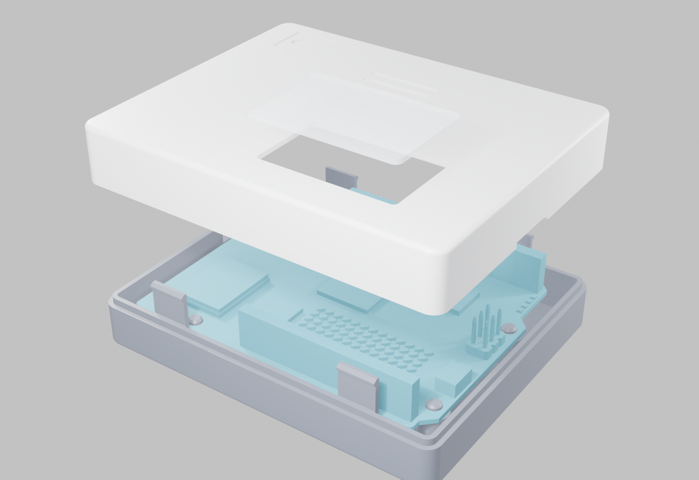

# Arduino UNO Q snap-fit case

A two-part 3D-printable case for the Arduino UNO Q: no screws, a window over
the LED matrix, a USB-C opening, a built-in flexible power button and vents
over the SoC. The case is modelled as code with CadQuery, so every dimension
is a named parameter.



Current revision: **A**. Printed on a QIDI Q1 Pro; it fit on the first print.

This is an unofficial hobby project and is not affiliated with Arduino.

## Print it

Take the files from [case/revisions/revA/stl](case/revisions/revA/stl):

- `unoq-case_revA_base.stl`
- `unoq-case_revA_lid_print.stl` (already flipped for printing)
- `unoq-case_revA_window.stl` (optional clear insert for the LED window)

No supports are needed. Print settings and assembly steps are in
[case/README.md](case/README.md). STEP files for CAD tools are in
[case/revisions/revA/step](case/revisions/revA/step).

## Change it

You need Python 3.10 or newer.

```bash
git clone https://github.com/mdemin729/arduino-uno-q.git
```

```bash
cd arduino-uno-q/case
```

```bash
pip install -r requirements.txt
```

```bash
python scripts/unoq_case.py
```

```bash
python scripts/check_fit.py
```

The first script writes STL and STEP files into `case/build/`. The second
intersects the case with Arduino's board model and must report 0 interfering
solids. All tunable values, such as wall thickness, clearances and the
button height, are constants at the top of
[case/scripts/unoq_case.py](case/scripts/unoq_case.py).

## How it was made

The model was written by Claude Code in one session from eight questions and
two photos of the board. Board dimensions come from Arduino's official STEP
model, not from the photos. [AGENTS.md](AGENTS.md) holds the instructions
agents follow when working in this repository.

## Repository layout

| Path | Contents |
|------|----------|
| `case/scripts/` | Parametric model, fit check, render and release scripts |
| `case/reference/` | Arduino's board model, used by the fit check |
| `case/revisions/` | Frozen releases, one folder per revision |
| `case/build/` | Generated working files, not in git |
| `case/REVISIONS.md` | Revision history |
| `AGENTS.md` | Instructions for AI coding agents |

## Licence

- **Code** (the Python scripts): MIT, see [LICENSE](LICENSE).
- **Case design and documentation** (STL and STEP files of the case, renders,
  Markdown files): Creative Commons Attribution-ShareAlike 4.0, see
  [LICENSE-CC-BY-SA-4.0](LICENSE-CC-BY-SA-4.0).
- **Arduino's board model**: `case/reference/unoq_board_simplified.stp` and
  the `..._board_reference.stl` files derived from it are the work of
  Arduino, published in the Arduino documentation under CC BY-SA 4.0. Details
  are in [case/reference/README.md](case/reference/README.md).

Arduino and UNO are trademarks of Arduino S.r.l.
